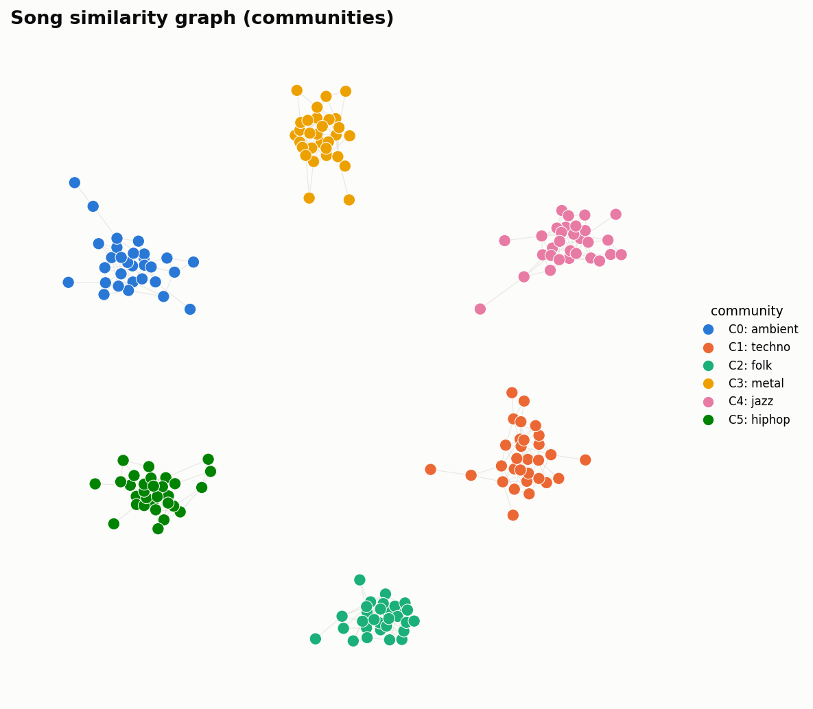
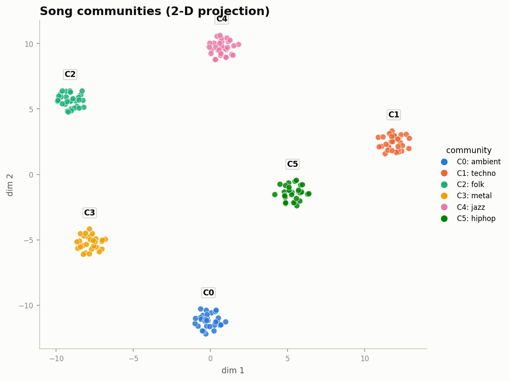
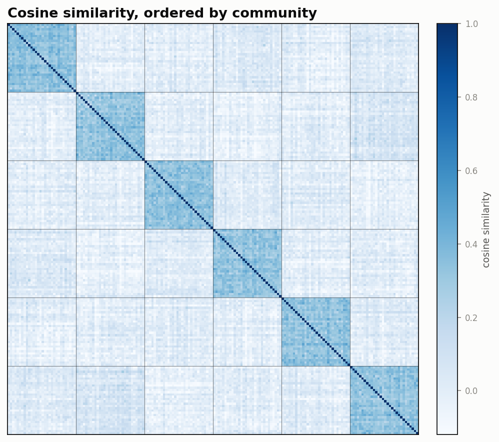

# audio-similarity

Find songs that **sound** alike — similar genre, mood, instrumentation, and
production — from the audio itself, not from artist or genre metadata.

**Pipeline:** segment each track → embed each segment with a pretrained music
encoder (CLAP) → mean-pool to a song vector → rank by cosine similarity →
evaluate with tag-overlap metrics on an [MTG-Jamendo](https://mtg.github.io/mtg-jamendo-dataset)
subset. See [PLAN.md](PLAN.md) for the full design and milestones.

```
MTG-Jamendo shards ─▶ subset ─▶ load+resample(48k mono) ─▶ segment(10s/5s hop)
   ─▶ CLAP embed ─▶ mean-pool + L2-norm ─▶ song index ─▶ cosine top-k ─▶ evaluate
```

## Install

Python 3.9+. CLAP runs on CPU/MPS on Apple Silicon; a GPU is optional.

```bash
python3 -m venv .venv && source .venv/bin/activate
pip install -e .            # add ".[dev]" for pytest, ".[notebook]" for the listening notebook
```

## Quickstart

```bash
# 1. Metadata (small; downloads a tag TSV from the MTG-Jamendo repo)
audio-sim download-metadata --name autotagging

# 2. Audio. Full MTG-Jamendo is ~508 GB, so grab a subset. Easiest path:
#    clone the dataset repo and let its script fetch the smallest labeled,
#    low-quality-audio subset (~46 GB), then copy just the tracks we sampled.
#    (Or point data/raw at ANY folder of audio files and skip MTG entirely.)
git clone https://github.com/MTG/mtg-jamendo-dataset
python3 mtg-jamendo-dataset/scripts/download/download.py \
    --dataset autotagging_moodtheme --type audio-low --from mtg-fast \
    data/_full --unpack --remove

# 3. Pick a genre-balanced ~1.5k-track subset and embed it
audio-sim subset --n 1500 --category genre
audio-sim embed

# 4. Query and evaluate
audio-sim query --key <TRACK_ID>
audio-sim query --text "mellow jazz guitar"     # CLAP text->audio search
audio-sim evaluate --k 10
```

`audio-sim info` shows config and how many tracks/embeddings are present.

> If you downloaded the full subset to `data/_full`, copy only the sampled
> tracks into `data/raw` with `copy_subset` (see `src/audio_similarity/data/download.py`)
> so you embed ~1.5k files, not all of them.

## How it works (modules)

| Stage | Module | Notes |
| --- | --- | --- |
| Config | `config.py` | typed, loaded from `config.yaml` |
| Metadata / subset | `data/metadata.py`, `data/subset.py` | parse tag TSVs; genre-stratified sampling |
| Download | `data/download.py` | fetch TSVs; wrap the official audio downloader |
| Preprocess | `preprocess/loader.py`, `preprocess/segment.py` | mono/resample; 10 s windows, 5 s hop |
| Embed | `embed/base.py`, `embed/clap.py`, `embed/runner.py` | swappable `Embedder`; per-track `.npz` cache |
| Aggregate | `aggregate.py` | mean pool + L2 normalize |
| Index / search | `index/store.py`, `index/search.py` | `.npz` index; cosine top-k (FAISS later) |
| Evaluate | `evaluate/metrics.py`, `evaluate/run_eval.py` | precision@k, Jaccard, nDCG vs a random floor |
| Visualize | `visualize.py` | kNN graph + Louvain communities, projection scatter, similarity heatmap |

The encoder sits behind a tiny `Embedder` interface (`embed_segments` in,
vectors out, at a declared sample rate), so Discogs-EffNet and other models drop
in without touching the rest of the pipeline (milestone 2).

## Evaluation

There is no ground-truth "these two sound alike" label, so shared MTG-Jamendo
tags are the proxy. For every track we rank all others and score the ranking
per category (genre / instrument / mood/theme) and overall:

- **precision@k** — fraction of top-k sharing ≥1 tag with the query
- **Jaccard@k** — mean tag-set overlap
- **nDCG@k** — graded by tag Jaccard
- **random floor** — same metrics under random ranking; the bar to beat

Reports are written to `embeddings/eval_report.{json,md}`.

## Visualizing communities

`audio-sim visualize` finds **communities** of mutually-similar songs and draws
three complementary views. It builds a mutual-kNN cosine graph, partitions it
with Louvain (modularity) community detection, and writes figures +
`communities.md` (dominant tags per community) to `embeddings/figures/`.

```bash
pip install -e .[viz]                       # matplotlib + networkx
audio-sim visualize --k 10 --projection tsne   # pca | tsne | umap
python scripts/visualize_demo.py            # example figures on synthetic data
```

Example output (synthetic data, six genre clusters — `scripts/visualize_demo.py`):

| Similarity graph | 2-D projection | Similarity heatmap |
| --- | --- | --- |
|  |  |  |

- **graph** — each node a song, edges = top-k cosine neighbors, color = community
- **projection** — PCA/t-SNE/UMAP of the song vectors, color = community (centroid-labeled)
- **heatmap** — cosine matrix reordered by community; the dark diagonal blocks *are* the communities

Colors use a colorblind-validated categorical palette; the heatmap uses a
single-hue magnitude ramp. `visualize.py` also exposes `build_knn_graph`,
`detect_communities`, `project_2d`, and `summarize_communities` for notebooks.

## Tests

```bash
PYTHONPATH=src python3 -m unittest discover -s tests     # no extra deps
# or, with dev extras:
pytest
```

The pure-logic layers (segmenting, pooling, metrics, search, subset, and the
store→search→evaluate path) are covered without needing torch or audio files.

## Notes

- **Apple Silicon:** CLAP (PyTorch) installs cleanly and uses MPS. Set
  `model.device: cpu` in `config.yaml` if you hit an MPS kernel gap.
- **torch / checkpoint loading:** `larger_clap_music` ships only pickle (`.bin`)
  weights, which transformers won't `torch.load` on torch < 2.6
  (CVE-2025-32434). `ClapEmbedder` handles this: on first load it converts the
  cached weights to safetensors with a safe `weights_only=True` load, so
  embedding works on torch 2.2+ without upgrading. `scripts/clap_smoke.py`
  prints what the vectors look like (shape, norm, cosine structure).
- **Licensing:** `laion/larger_clap_music` is research-friendly; Discogs-EffNet
  (milestone 2) is CC BY-NC-SA 4.0 (non-commercial). MTG-Jamendo audio is
  Creative Commons.
